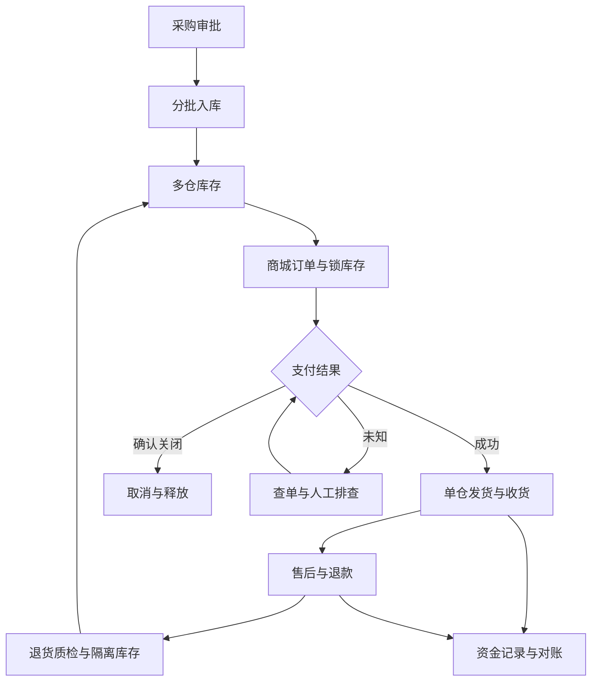

# 智采商城｜产品文档

版本：v0.2 · 日期：2026-10-20 · 状态：首版需求评审稿

项目暂名：智采商城（Zhicai）。目标：由用户与 AI 协作完成可运行、可验证、可部署的 Java 全栈项目。本文不是已上线产品的说明，功能、性能与页面均为拟实现目标。

## 1. 决策来源与阅读顺序

### 1.1 用户已确认

| 编号 | 决策 |
|---|---|
| U01 | 电脑及数码配件自营商城，与采购、库存、发货、售后一体化 |
| U02 | 顾客商城适配电脑和手机浏览器；管理端以电脑为主 |
| U03 | 商城使用深色电竞风；主视觉采用真实摄影感的绿色/青蓝色极光，横向连续、光丝克制、倒影减弱；修改重点为视觉与页面布局 |
| U04 | 管理端采用清爽工作台：左侧导航、顶部工具栏、紧凑表格、独立详情页 |
| U05 | 多仓库，每笔订单只由一个仓库履约 |
| U06 | 模拟支付 + 可用支付沙箱，覆盖成功、失败、回调、退款 |
| U07 | 采购审批、分批入库、收付款记录、业务对账 |
| U08 | 商城主视觉使用绿色为主、青蓝色辅助的真实极光方向；管理端采用浅色清爽工作台，不铺满极光背景 |
| U09 | 基础商品评分与评价纳入v1.0；不把评价/评分模块强制放在商城首页 |
| U10 | 采用“教练 + 开发搭档”协作：AI协助设计与编码，核心Spring Boot模块需解释、运行、测试和验收 |

### 1.2 建议默认值（尚未逐项获得用户确认）

| 编号 | 建议 | 影响 |
|---|---|---|
| D01 | 单企业自营，人民币、中文、国内收货地址 | 不涉及第三方商家结算、跨境和多租户 |
| D03 | 首版统一包邮，商品标价即成交计算基础，不单列税费 | 暂不引入运费模板、发票与会计核算 |
| D04 | 未支付订单有效期30分钟；收货后7天内允许在线申请售后 | 可配置的演示业务规则，并非法律或平台政策结论 |
| D05 | 用户名密码登录，商城账户与员工账户分开；不接短信注册 | 避免外部短信依赖；暂不支持找回密码自助流程 |
| D06 | 固定面额满减券；每单最多1张；不与其他促销叠加 | 限制首版计价复杂度，保留扩展点 |
| D07 | 库存足够的仓库按业务优先级、仓库ID顺序选取 | 暂不接地理距离计算或自动最优物流 |
| D08 | 首版每单一次发货；物流单号人工录入 | 不接实时物流；不拆包裹、不分批发货 |
| D09 | 采购单一级审批，提交人与审批人不得相同 | 练习职责分离，不引入通用工作流引擎 |
| D10 | 先做模块化单体，最后加入缓存、消息队列与搜索 | 业务正确性先于中间件集成 |

未确认的建议不伪装为既定需求。开发前按阶段复核对应默认值；不必等待所有外围决策才开始基础功能。

### 1.3 文档职责

- 本文：产品目标、页面、视觉与范围。
- `02-需求文档.md`：业务规则、状态、角色、验收条件，作为业务事实源。
- `03-接口文档.md`：使用说明、接口目录、请求响应字段及错误语义。
- `04-开发文档.md`：架构、数据表、算法、事务、测试、部署。
- `05-openapi.yaml`：机器可读的拟实现接口合同；与接口文档由同一模型生成。不是已运行服务的自动导出文件。

发生冲突先记录变更决定，再同步所有受影响文档；AI 不得自行选择某份文档并默默修改业务含义。

## 2. 产品目标与成功标准

1. 顾客可完成浏览、筛选、购买、支付、收货与售后。
2. 企业可完成采购、分批入库、库存分配、调拨、发货与资金核对。
3. 每次库存和资金变化可追溯到业务单据与操作人。
4. 并发、重复请求、外部结果未知时，系统行为有明确规则。
5. 用户可以解释主要数据模型、Service 事务、权限和中间件的使用理由。

以验收场景通过率、数据一致性、关键路径可复现部署为成果标准。页面数量、代码行数、技术名词数量不作为完成标准。

## 3. 用户与使用场景

| 角色 | 核心任务 | 默认数据范围 |
|---|---|---|
| 访客 | 搜索商品、查看规格与价格 | 已上架公开商品 |
| 顾客 CUSTOMER | 购物车、地址、订单、支付、售后、站内通知 | 本人数据 |
| 运营 OPERATOR | 商品维护、上下架、优惠券、销售订单查询 | 企业商品与交易业务；无采购价和付款权限 |
| 采购 PURCHASER | 供应商、采购单、提交审批 | 本人创建采购单及关联记录 |
| 主管 APPROVER | 采购/调拨审核、报表查看 | 企业单据，禁止审批本人提交的采购单 |
| 仓管 WAREHOUSE | 入库、发货、退货验收、调拨、库存调整 | 被分配仓库；跨仓流程按动作分别校验 |
| 客服 SUPPORT | 售后审核、客户订单查询 | 处理售后所需数据，地址/电话默认脱敏 |
| 财务 FINANCE | 采购付款、退款执行、对账 | 企业资金与相关业务凭据 |
| 系统管理员 ADMIN | 员工、角色、仓库授权、系统设置 | 系统配置；不能绕过业务状态与不可变账目规则 |

角色为默认模板，可组合；接口按权限码和数据范围授权。演示环境也应有独立采购员和审批人账户。

## 4. 业务全景与范围

### 4.1 完整 v1.0 必做范围

账户权限、商品与SKU、购物车、地址、计价、单仓履约、库存预留、支付适配、一次发货、确认收货、采购审批、分批入库、供应商退货、多仓调拨、库存流水、库存调整审核、优惠券、售后退货退款、采购付款、对账、报表、通知、操作日志、图片上传、异步报表导出、基础监控与部署。

### 4.2 渐进交付

| 里程碑 | 范围 | 必须能演示 |
|---|---|---|
| M0 | 工程、数据库、角色、8个代表页面分两轮评审 | 首轮先评审C01首页、C03商品详情、A08订单列表；后台登录可用，评价范围与接口合同纳入设计 |
| M1 | 商品、地址、购物车、订单、模拟支付、一次发货 | 顾客完整购买；没有采购功能时用明确的开发种子库存 |
| M2 | 采购、入库、退货、调拨、库存调整 | 用采购真实增加库存，完整追溯来源 |
| M3 | 优惠券、售后、退款、采购付款、对账、报表 | 从优惠成交到退货退款、资金核对完整闭环 |
| M4 | Redis、RabbitMQ、搜索索引、异步导出与通知 | 缓存失效、消息重试、索引重建都可演示 |
| M5 | 支付沙箱适配、部署、集成测试、并发和故障演练 | 可重复部署；沙箱条件具备时验收真实沙箱回调 |

M1 是可运行的早期版本，不代表最终项目已完成。M5 的沙箱部分若外部账号不可用，必须标记阻塞并列出未验收项。

### 4.3 后续扩展

多商家、多租户、拆单发货、秒杀、账期授信、完整应收应付、会计凭证、发票、自动物流、短信、微信小程序、微服务、序列号保修、个性化商品推荐算法留作 v1.x 或 v2。v1.0纳入基础商品评分与评价闭环：已完成订单商品评价、1–5星评分、可选文字/图片、后台审核、公开评价列表及商品评分汇总；不包含评价点赞、复杂反作弊或AI自动审核。此次包含商品搜索及销量统计，不声称覆盖全部电商与 ERP 功能。

## 5. 页面信息架构

当前规划59个功能页面模板：商城16、管理端43（新增A43商品评价审核）。完整逐页编号、路由、设计优先级和弹层清单见`06-页面清单与设计交接.md`。这是规划数量，非已实现页面数；新增/编辑共用一个模板。现有v0.1 HTML原型只有商城首页与管理工作台两个演示视图，待按已确认的视觉基线改版。

### 5.1 商城（desktop + mobile web）

| 页面 | 建议路由 | 主要内容与动作 |
|---|---|---|
| 首页 | `/` | 品牌区、分类导航、精选商品、新品区；首版用后台精选标记，不搭建CMS |
| 搜索/分类 | `/products` | 关键词、分类、品牌、价格区间、价格/上架时间排序、分页、评分均值与评价数量摘要 |
| 商品详情 | `/products/:id` | 图片、参数、规格选择、价格、可售提示、加入购物车/立即购买、评分汇总与公开评价列表/分页 |
| 登录/注册 | `/login`、`/register` | 用户名密码，错误提示、登录后返回原页面 |
| 购物车 | `/cart` | 勾选、数量、失效商品说明、去结算 |
| 确认订单 | `/checkout` | 地址、商品快照、可用券、金额；仓库由后端选择 |
| 支付结果 | `/payments/:id` | 待支付/处理中/成功/失败/已关闭；主动查询服务器状态 |
| 订单列表/详情 | `/account/orders`、`/account/orders/:id` | 状态筛选、时间线、取消、支付、确认收货、售后；订单完成后可评价未评价的订单商品 |
| 地址与优惠券 | `/account/addresses`、`/account/coupons` | 编辑地址、设默认地址、查看领取和使用状态 |
| 售后列表/详情 | `/account/after-sales`、`/account/after-sales/:id` | 类型、数量、理由、审核结果、退货物流、退款进度 |
| 个人中心/通知 | `/account`、`/account/notifications` | 基本信息、修改密码、订单入口、本人评价状态、通知已读 |

### 5.2 管理端（desktop）

| 一级导航 | 二级页面 | 列表/详情中的关键内容 |
|---|---|---|
| 工作台 | 概览 | 待审核、待发货、待退款、低库存、对账差异 |
| 商品 | 商品、分类、品牌、评价审核 | SKU规格/价格、上架校验、图片、库存只读；评价审核单独路由 `/admin/reviews` |
| 交易 | 订单、发货、售后 | 单仓归属、金额、状态、日志、关联付款退款 |
| 营销 | 优惠券模板 | 门槛、面额、发放总量、时间与领取情况 |
| 采购 | 供应商、采购单、入库记录、采购退货 | 单据明细、审批历史、已收/待收数量 |
| 仓储 | 仓库、库存、流水、调拨、调整 | 可售/锁定/隔离/在途；仓库范围筛选 |
| 资金 | 收支记录、采购付款、退款、对账 | 单据关联、渠道状态、差异处理，不允许直接编辑已记账金额 |
| 报表 | 销售、库存预警、导出任务 | 时间、仓库、状态口径；任务完成后下载 |
| 系统 | 员工、角色、仓库授权、审计日志、运行设置 | 权限树、授权范围、操作来源与结果 |

详情页顶部显示单据号、状态、主要动作；中间为基本信息和明细；底部为操作时间线与相关单据链接。按钮出现条件与接口权限、状态共同决定。

## 6. 视觉与交互规格（建议稿）

### 6.1 商城设计令牌

| 用途 | 建议值 |
|---|---|
| 页面底色 | `#07111F` |
| 卡片底色 | `#0D1C2B` |
| 一级文字 | `#F2F7FB` |
| 次级文字 | `#9FB5C7` |
| 主操作色 | `#31D5A6`（青绿色） |
| 辅助高亮 | `#32BBD7`（青蓝色） |
| 边框 | `#233B4C` |
| 字体 | 系统无衬线中文字体栈；价格可用等宽数字特性 |
| 圆角/间距 | 卡片12px、按钮8px；间距8/12/16/24/32px |

深色电竞风通过颜色和产品图表达；关键参数、价格、错误信息保持清晰。发光装饰不能承载唯一状态信息。文字/背景对比度在实现阶段检测，普通文本目标不低于4.5:1。

### 6.2 商城页面布局

- 桌面：内容最大宽度1280px；顶部品牌、搜索、分类、账户和购物车；首页一个主视觉区域，下面按精选/新品展示卡片。
- 商品列表：桌面左侧筛选、右侧3至4列商品；手机筛选抽屉、2列商品；价格/规格不得被装饰遮挡。
- 商品详情：桌面图片与购买区双栏；手机纵向，底部购买栏为安全区域预留空间。未选规格时购买按钮提示选择，不任意默认购买高价规格。
- 手机底部导航：首页、分类/搜索、购物车、我的。结算页使用提交订单操作栏，不叠加底部导航。
- 断点参考：<768px手机、768–1199px平板、≥1200px桌面；验收宽度390/768/1440px。

### 6.3 管理端设计令牌与布局

- 页面底色`#F5F7FA`，内容白色，文字`#1F2937`，主操作色建议`#0F9D87`，辅助高亮可使用低饱和青蓝色。
- 左侧导航宽224px，可折叠为64px；顶部56px；内容区24px内边距。
- 列表顶部：标题/说明 → 搜索筛选 → 操作栏 → 表格 → 分页。
- 表格行高约44px；金额右对齐；状态用文字加颜色；固定单据号和必要操作列；横向溢出只发生在表格容器。
- 状态筛选保存在URL查询参数；从详情返回保留筛选与页码。长表单离开前提示未保存内容。
- 危险操作（撤销、退款、库存调整）展示影响与原因输入；重复点击时按钮禁用，服务端仍必须幂等。

### 6.4 所有页面必须包含的状态

加载、空数据、无搜索结果、网络失败重试、无权限、会话过期、业务冲突、提交处理中、成功反馈。未完成的功能不得以假成功提示代替。

键盘能访问主要按钮；输入框有标签；错误定位到字段；动画尊重减少动态效果偏好。个人信息和令牌不得出现在普通日志或演示截图中。

### 6.5 工作台数据装配原则

- `GET /api/v1/admin/dashboard`只负责五类待办计数，不返回所有工作台内容。
- `GET /api/v1/admin/reports/sales`返回指定时间范围的收退款汇总与趋势点；近期订单、采购待审批明细等复用各自业务查询接口。
- 前端通过统一API客户端与`useDashboardData()`组合层并行加载所需数据；每个面板独立处理加载、空态和错误，单个接口失败不应清空整页。
- 只有在测量到请求开销或首屏时延确实成为问题后，才考虑新增工作台概览聚合接口；聚合层只组合数据，不复制订单、库存、财务业务规则。

## 7. 代表页面评审清单

先完成8个代表页面的两轮评审：C01商城首页、C02商品列表、C03商品详情、C07确认订单、A02管理工作台、A08订单列表、A09订单详情、A16采购单编辑。第一轮优先C01、C03、A08；其余用于验证组件复用。当前v0.3 HTML视觉原型已包含C01、C02、C03、C07、A02、A08、A09、A16八个静态/本地交互演示视图，不声称已接通API。

- 商城首页：使用用户选定的真实极光摄影方向；不在首页堆放商品评价/评分模块，主视觉需兼顾商品与分类导航。
- 商品详情：规格选中/缺货/价格变化如何表现？购买栏是否挡住内容？评分摘要、评价列表、图片评价和分页是否清楚？
- 管理端订单列表：单据号、顾客、仓库、金额、状态、时间、操作是否清晰？筛选和详情返回是否连贯？
- 同时查看正常、空、错误、无权限四种状态；确认令牌再铺开其他页面。

## 8. 待核实事项与下一次评审

| 事项 | 当前默认 | 应在何时确认 |
|---|---|---|
| 正式名称/Logo | 智采商城，文字Logo | M0 页面评审 |
| 绿色/青蓝色配色、字体 | 本文建议值，参考用户选定极光图 | M0 页面评审 |
| 包邮、优惠券规则、售后期限 | D03/D04/D06 | 对应模块开工前 |
| 首个沙箱渠道及账号 | 未选择，不虚构回调格式 | 支付适配器开工前 |
| 开发电脑资源、数据库/容器环境 | 未提供 | M0 环境检查 |
| 部署服务器、域名、图片存储服务 | 未提供 | M5 前 |
| 数据与图片来源 | 自建演示数据/合法可用图片 | 种子数据准备时 |

## 9. 参考来源

- [mall 原仓库](https://github.com/macrozheng/mall)：交易、商品、搜索、工程组织参考。
- [jshERP 原仓库](https://github.com/jishenghua/jshERP)：采购、库存、资金记录业务参考。

本项目为重新设计的学习实现；本文所列功能不等于两个仓库现有功能的逐项复述，也不默认复制其代码、图片或商标。
